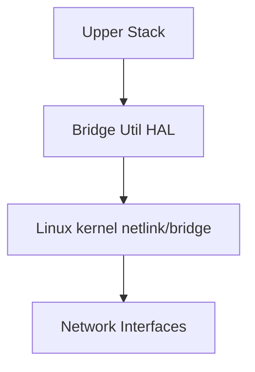
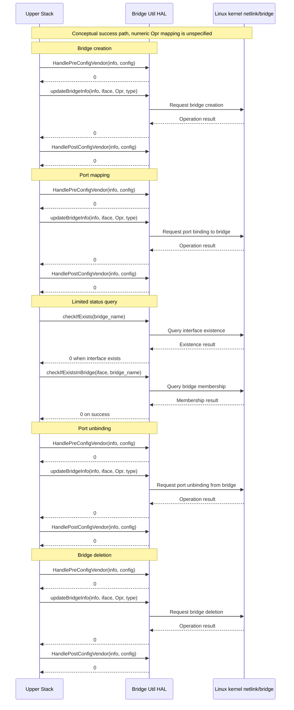

# Bridge Util HAL Documentation

## Acronyms

- `HAL` \- Hardware Abstraction Layer
- `RDK-B` \- Reference Design Kit for Broadband Devices
- `OEM` \- Original Equipment Manufacture
- `OVS` \- Open vSwitch

## Description

Bridge Util HAL abstracts vendor-specific bridge configuration and interface management. The public contract is declared in [bridge_util_hal.h](../../include/bridge_util_hal.h), with companion network configuration types in [network_interface.h](../../include/network_interface.h). This repository contains the interface headers rather than a vendor implementation. The declarations and their comments establish the available API; the diagrams below describe the conceptual Linux integration, not a verified implementation path or additional API guarantees.

The upper stack supplies bridge details and invokes vendor hooks around bridge mutations. A vendor implementation translates these requests into platform networking operations. The Linux kernel netlink/bridge layer and its network interfaces represent the intended integration boundary; neither public header requires a particular netlink implementation, driver, or command-line tool.

## Component Runtime Execution Requirements

### Initialization and Startup

The public headers do not declare a dedicated initialization or shutdown function. `HandlePreConfigVendor(bridgeInfo, InstanceNumber)` applies OEM/SoC-specific configuration before the client calls `updateBridgeInfo()`, and `HandlePostConfigVendor(bridgeInfo, Config)` applies it afterward. These are per-operation hooks for bridge creation, update, or deletion, not documented one-time initialization APIs. Both configuration arguments use values from `enum Config`, passed as `int`.

Vendors are expected to ensure operational readiness before completing synchronous operations. The headers do not specify readiness checks, a boot-time initialization sequence, or recovery and hook ordering after a failed mutation. These remain contract gaps rather than implied lifecycle guarantees.

## Threading Model

The interface is not required to be thread-safe.

Any module invoking the Bridge Util HAL API should serialize calls as needed. The shared globals and logging buffers declared in the public header make synchronization an integration concern; no locking protocol is specified.

Vendors can create internal threads/events for operational needs, but must ensure synchronization before closure cleanup.

## Process Model

APIs are expected to be called from multiple processes. This is an integration expectation, not evidence of implemented cross-process coordination: the headers do not define operation serialization, isolation, or conflict resolution between callers.

## Memory Model

### Caller Responsibilities

Ownership of Memory: Callers must assume full responsibility for managing any memory explicitly given to the module functions to populate. This includes proper allocation and de-allocation to prevent memory leaks.

The `bridgeDetails` object and its fixed-size arrays remain caller-owned. The hooks and `updateBridgeInfo()` document this object as input, but their non-const pointer signatures do not establish immutability or a retention/lifetime policy. Name and list arguments remain caller-owned as well. Supply valid storage for synchronous calls; do not infer ownership transfer from a pointer argument.

`removeIfaceFromList()` removes an entry from the supplied list, so the caller must provide writable list storage even though the header annotates `str` as input. Its `sub` argument is `const char *`. No allocation size or capacity argument is provided.

`getVendorIfaces()` returns a zero-terminated string or `NULL` when there are no interfaces. Its allocation owner, lifetime, mutability, reuse across calls, and release mechanism are not specified. Neither freeing the pointer nor treating it as permanently valid is contract-backed; integration must resolve ownership with the vendor. `NULL` must not automatically be interpreted as an error because it has a documented no-interfaces meaning.

### Module Responsibilities

Internal Memory Handling: Modules must independently allocate and de-allocate memory for their internal operations, ensuring efficient resource management.

Mandatory Cleanup: Modules are required to release all internally allocated memory upon closure to prevent resource leaks.

No numeric memory-footprint budget is defined in the public contract.

## Power Management Requirements

The HAL is not involved in any of the power management operation.

## Asynchronous Notification Model

There are no asynchronous notifications.

## Blocking calls

The API's are expected to work synchronously and should complete within a time period commensurate with the complexity of the operation and in accordance with any relevant specification.

Any calls that can fail due to the lack of a response should have a timeout period in accordance with any API documentation.

No numeric completion target or timeout is specified in either public header. A test or integration timeout therefore requires a separately declared environment policy and must not be presented as a HAL requirement.

## Internal Error Handling

The five `int`-returning functions document `0` for success and `-1` for failure. `checkIfExists()` names these values `INTERFACE_EXIST` and `INTERFACE_NOT_EXIST`. The contract does not provide distinct error codes for invalid input, missing objects, resource exhaustion, or vendor failures, nor does it define `errno` behavior.

`removeIfaceFromList()` returns `void`; an absent entry is expressly a no-op without an error report. `getVendorIfaces()` returns a string pointer or `NULL`, not an integer status. The HAL is responsible for handling system errors internally, but these two APIs do not expose a separate diagnostic status channel.

## Persistence Model

There is no requirement for HAL to persist any setting information.

## Nonfunctional requirements

Following non functional requirement should be supported by the component.

## Logging and debugging requirements

The Bridge util HAL component must record all errors and critical informative messages. This can be achieved by using either the printf or the syslog method. These tools are useful in identifying, and debugging the issues and understanding the functional flow of the system.

It is recommended that each HAL component follows the same logging process. If logging is required, vendors should log in to the `bridgeUtils.log` file, which can be found in the `/var/tmp/` or `/rdklogs/logs/` directories.  

Existing integration guidance recommends severity-tagged logging with labels such as FATAL, ERROR, WARNING, NOTICE, INFO, DEBUG, and TRACE. These are application logging labels rather than the Linux syslog priority set. The public logging macro declares neither a severity parameter nor a level-filtering policy; its fixed log-path constant is documented below.

## Memory and performance requirements

The component should not contributing more to memory and CPU utilization while performing normal operations and Commensurate with the operation required.

## Quality Control

Bridge util HAL implementation should pass checks using any third-party tools like `Coverity`, `Black Duck`, `Valgrind` etc. without any issues to ensure quality.

There should not be any memory leaks/corruption introduced by HAL and underneath 3rd party software implementation.

## Licensing

Bridge Util HAL implementation is expected to released under the Apache License 2.0.

## Build Requirements

The source code should be able to be built under Linux Yocto environment and should be delivered as a shared library named as `libhalbridge_utils.so`

## Variability Management

Changes to the interface will be controlled by versioning, vendors will be expected to implement to a fixed version of the interface, and based on SLA agreements move to later versions as demand requires.

Each API interface will be versioned using [Semantic Versioning 2.0.0](https://semver.org/), the vendor code will comply with a specific version of the interface.

## WAN or Product Customization

None

## Interface API Documentation

Components include [bridge_util_hal.h](../../include/bridge_util_hal.h) to use the seven declared HAL functions. [network_interface.h](../../include/network_interface.h) supplies companion data types intended to remove the build-time bridge-utility dependency from OVS; it declares no functions.

The earlier integration guidance names `libbridge_utils.so` as a linker dependency, while Build Requirements names `libhalbridge_utils.so` as the delivered library. The headers and this interface-only repository do not resolve the discrepancy. The correct deployed library name must be confirmed before native binding or linking.

### Complete API table

The signatures below retain the declared names and parameter types. Names shown in older prose such as `checkIfExist()` and `checkIfExistinBridge()` are not declared APIs.

| Declaration | Documented behavior and inputs | Return contract and limits |
| --- | --- | --- |
| `int updateBridgeInfo(bridgeDetails *bridgeInfo, char *ifNameToBeUpdated, int Opr, int type);` | Creates, updates, or deletes bridge configuration described by `bridgeInfo`. The zero-terminated `ifNameToBeUpdated` is applicable during synchronization; examples are `moca0`, `wifi0`, and `eth0`. `Opr` is described as an `enum OVS_CMD` value cast to `int`. `type` is an `enum INTERFACE_TYPE` value cast to `int`; synchronization deletion uses `IF_OTHER_BRIDGEUTIL`. | `0` on success; `-1` on failure. `enum OVS_CMD` is absent from both headers, so numeric operation mapping and behavior outside synchronization are unresolved. |
| `int checkIfExists(char *iface_name);` | Checks whether a vendor-specific interface exists. | `0` (`INTERFACE_EXIST`) on success; `-1` (`INTERFACE_NOT_EXIST`) on failure. The return does not distinguish all possible causes of failure. |
| `void removeIfaceFromList(char *str, const char *sub);` | Removes `sub` from the interface-name list `str`; the header gives the list example `wl0 wl11 moca0 ath0 eth3`. The list must be writable for removal. | No return value. If the specified name is absent, no action is taken and no error is reported. Exact token matching and whitespace normalization are unspecified. |
| `int checkIfExistsInBridge(char *iface_name, char *bridge_name);` | Checks whether an interface is attached to a bridge; examples include `eth0` and `brlan0`. This is a membership query, not a link-state or forwarding query. | `0` on success; `-1` on failure. Behavior for a nonexistent bridge is not separately defined. |
| `int HandlePreConfigVendor(bridgeDetails *bridgeInfo, int InstanceNumber);` | Applies OEM/SoC-specific configuration before `updateBridgeInfo()`. `InstanceNumber` is an `enum Config` value cast to `int`. | `0` on success; `-1` on failure. Failure recovery and rollback are unspecified. |
| `int HandlePostConfigVendor(bridgeDetails *bridgeInfo, int Config);` | Applies OEM/SoC-specific configuration after `updateBridgeInfo()`. `Config` is an `enum Config` value cast to `int`. | `0` on success; `-1` on failure. Failure recovery and rollback are unspecified. |
| `char *getVendorIfaces();` | Retrieves a zero-terminated vendor interface-name string for bridge management. The declaration uses an empty parameter list rather than `(void)`. | Returns the string pointer, or `NULL` for no interfaces. Ownership, lifetime, delimiter format, and a separate failure indication are unspecified. In C/gnu11, this declaration is not a prototype specifying zero parameters. |

### Constants and buffer capacities

These are declared storage capacities and constants, not proof of kernel acceptance limits or input validation. Where strings are used, callers need room for their terminator. The three companion-header capacities explicitly include that terminator.

| Header | Symbol | Declared value and purpose |
| --- | --- | --- |
| `bridge_util_hal.h` | `BRIDGE_UTIL_LOG_FNAME` | `"/rdklogs/logs/bridgeUtils.log"`; log path. |
| `bridge_util_hal.h` | `GRE_HANDLER_SCRIPT` | `"/etc/utopia/service.d/service_multinet/handle_gre.sh"`; script path constant, not an implementation supplied here. |
| `bridge_util_hal.h` | `TOTAL_IFLIST_SIZE` | `1024`; total interface-list capacity constant. |
| `bridge_util_hal.h` | `BRIDGE_NAME_SIZE` | `64`; bridge and related name array capacity in `bridgeDetails`. |
| `bridge_util_hal.h` | `IFACE_NAME_SIZE` | `64`; interface-name capacity constant. |
| `bridge_util_hal.h` | `IFLIST_SIZE` | `256`; each per-type interface-list array capacity in `bridgeDetails`. |
| `bridge_util_hal.h` | `MAX_LOG_BUFF_SIZE` | `1024`; shared log buffer capacity. |
| `bridge_util_hal.h` | `TIMESTAMP` | `64`; additional timestamp buffer capacity. |
| `bridge_util_hal.h` | `INTERFACE_EXIST` | `0`; documented existence success. |
| `bridge_util_hal.h` | `INTERFACE_NOT_EXIST` | `-1`; documented existence failure. |
| `network_interface.h` | `MAX_IF_NAME_SIZE` | `16`; interface-name capacity including the null terminator. |
| `network_interface.h` | `MAX_IP_ADDR_SIZE` | `16`; dotted IPv4 address string capacity including the null terminator. |
| `network_interface.h` | `MAX_BRIDGE_NAME_SIZE` | `16`; bridge-name capacity including the null terminator. |

The `bridge_util_log(fmt ...)` function-like macro uses shared buffers, formats a UTC timestamp, and writes and flushes `logFp` when it is non-NULL. Despite its comment promising standard-output fallback, the macro body contains no such fallback. The macro is not an additional HAL function and does not establish a thread-safe logging API.

### Struct: bridgeDetails

This typedef and struct tag describe bridge configuration supplied to mutation and vendor-hook functions. The names and VLAN IDs in the comments are examples, not exhaustive valid-value ranges. The arrays are embedded storage, not separately allocated pointers.

| Field | Declared type and capacity | Meaning |
| --- | --- | --- |
| `bridgeName` | `char[BRIDGE_NAME_SIZE]` (`64`) | Bridge name, such as `brlan0`, `brlan1`, `privbr`, or `br-home`. |
| `vlan_name` | `char[BRIDGE_NAME_SIZE]` (`64`) | VLAN interface name, such as `vlan1` or `guest_vlan`. |
| `VirtualParentIfname` | `char[BRIDGE_NAME_SIZE]` (`64`) | Virtual parent interface name, such as `eth0` or `wan0`. |
| `vlanID` | `int` | VLAN ID; the header lists examples but no complete range. |
| `ethIfList` | `char[IFLIST_SIZE]` (`256`) | Ethernet interface-name list. |
| `MoCAIfList` | `char[IFLIST_SIZE]` (`256`) | MoCA interface-name list. |
| `GreIfList` | `char[IFLIST_SIZE]` (`256`) | GRE interface-name list. |
| `WiFiIfList` | `char[IFLIST_SIZE]` (`256`) | Wi-Fi interface-name list. |

### Struct: Gateway_Config_Non_Ovs_Bridge

The companion header declares this typedef and struct tag for Gateway Config table data. No function in either public header accepts this structure, and no conversion to `bridgeDetails` is defined.

| Field | Declared type and capacity | Meaning |
| --- | --- | --- |
| `if_name` | `char[MAX_IF_NAME_SIZE]` (`16`) | Network interface name. |
| `inet_addr` | `char[MAX_IP_ADDR_SIZE]` (`16`) | Network IP address. |
| `netmask` | `char[MAX_IP_ADDR_SIZE]` (`16`) | Network netmask. |
| `gre_remote_inet_addr` | `char[MAX_IP_ADDR_SIZE]` (`16`) | Remote GRE IP address. |
| `gre_local_inet_addr` | `char[MAX_IP_ADDR_SIZE]` (`16`) | Local GRE IP address. |
| `parent_ifname` | `char[MAX_IF_NAME_SIZE]` (`16`) | Parent interface name. |
| `parent_bridge` | `char[MAX_BRIDGE_NAME_SIZE]` (`16`) | Parent bridge name. |
| `mtu` | `int` | MTU in bytes; no allowed range is specified. |
| `vlan_id` | `int` | VLAN ID; no allowed range is specified. |
| `if_type` | `IF_TYPE` | Companion interface-type enum. |
| `if_cmd` | `BR_CMD` | Companion interface/bridge command enum. |

### Enums and conditional configuration values

`enum Config` in `bridge_util_hal.h` supplies configuration instance numbers for the vendor hooks. Conditional members are available only under the listed compile-time guards; an enum declaration does not establish that a particular DUT supports the feature.

| Member | Value | Availability |
| --- | --- | --- |
| `PRIVATE_LAN` | `1` | Unconditional. |
| `HOME_SECURITY` | `2` | Unconditional. |
| `HOTSPOT_2G` | `3` | Unconditional. |
| `HOTSPOT_5G` | `4` | Unconditional. |
| `LOST_N_FOUND` | `6` | Unconditional. |
| `HOTSPOT_SECURE_2G` | `7` | Unconditional. |
| `HOTSPOT_SECURE_5G` | `8` | Unconditional. |
| `MOCA_ISOLATION` | `9` | Unconditional. |
| `MESH_BACKHAUL` | `10` | Unconditional. |
| `ETH_BACKHAUL` | `11` | Unconditional. |
| `MESH` | `12` | Unconditional. |
| `MESH_WIFI_BACKHAUL_2G` | `13` | Unconditional. |
| `MESH_WIFI_BACKHAUL_5G` | `14` | Unconditional. |
| `MESH_ONBOARD` | `18` | Unconditional. |
| `MESH_WIFI_ONBOARD_2G` | `19` | Unconditional. |
| `MANAGE_WIFI_BRIDGE` | `17` | `WIFI_MANAGE_SUPPORTED` is defined. |
| `AMENITY_BRIDGE_2G` | `20` | `AMENITIES_NETWORK_ENABLED` is defined and `_CBR2_PRODUCT_REQ_` is not defined. |
| `AMENITY_BRIDGE_5G` | `21` | `AMENITIES_NETWORK_ENABLED` is defined and `_CBR2_PRODUCT_REQ_` is not defined. |
| `AMENITY_BRIDGE_6G` | `22` | `AMENITIES_NETWORK_ENABLED` is defined and `_CBR2_PRODUCT_REQ_` is not defined. |

The remaining four enums are listed completely below, including values assigned implicitly by C.

| Header and enum | Members and numeric values | Contract role |
| --- | --- | --- |
| `bridge_util_hal.h`: `enum INTERFACE_TYPE` | `IF_BRIDGE_BRIDGEUTIL = 1`, `IF_VLAN_BRIDGEUTIL = 2`, `IF_GRE_BRIDGEUTIL = 3`, `IF_MOCA_BRIDGEUTIL = 4`, `IF_WIFI_BRIDGEUTIL = 5`, `IF_ETH_BRIDGEUTIL = 6`, `IF_OTHER_BRIDGEUTIL = 7`. | Supplies the `type` argument of `updateBridgeInfo()` as an `int`. |
| `bridge_util_hal.h`: `enum BridgeOpr` | `DELETE_BRIDGE = 0`, `CREATE_BRIDGE = 1`. | Declares bridge operation names, but the `updateBridgeInfo()` comment refers instead to missing `enum OVS_CMD`; these values must not be assumed to replace it. |
| `network_interface.h`: `IF_TYPE` (tag `IF_TYPE`) | `OTHER_IF_TYPE = 0`, `BRIDGE_IF_TYPE = 1`, `ETH_IF_TYPE = 2`, `GRE_IF_TYPE = 3`, `VLAN_IF_TYPE = 4`. | Supplies `Gateway_Config_Non_Ovs_Bridge.if_type`. |
| `network_interface.h`: `BR_CMD` (tag `BR_CMD`) | `IF_UP_CMD = 0`, `IF_DOWN_CMD = 1`, `IF_DELETE_CMD = 2`, `BR_REMOVE_CMD = 3`. | Supplies `Gateway_Config_Non_Ovs_Bridge.if_cmd`; no mapping to the missing `OVS_CMD` is declared. |

The interface-type enums have different numeric assignments and are not interchangeable. Likewise, neither `BR_CMD` nor `BridgeOpr` establishes the accepted `Opr` mapping for `updateBridgeInfo()`.

### Shared globals and integration ownership

The public HAL header declares the following external objects and explicitly notes that the module is not self-contained. The component provides declarations rather than definitions or initialization rules. An integrator must resolve the symbols and their synchronization/ownership policy with the vendor; tests must not assume independent per-call or per-instance state.

| Declared object | Type | Header meaning or use |
| --- | --- | --- |
| `DeviceMode` | `int` | Router mode `0`, bridge mode `2` according to the comment. |
| `MocaIsolation_Val` | `int` | MoCA isolation value. |
| `need_wifi_gw_refresh` | `int` | Wi-Fi gateway refresh flag. |
| `need_switch_gw_refresh` | `int` | Switch gateway refresh flag. |
| `syncMembers` | `int` | Synchronization variable. |
| `BridgeOprInPropgress` | `int` | Bridge-operation-in-progress flag; spelling follows the header. |
| `logFp` | `FILE *` | Shared logging stream pointer; opening and closing ownership are unspecified. |
| `log_buff` | `char[MAX_LOG_BUFF_SIZE]` | Shared log formatting buffer. |
| `log_msg_wtime` | `char[MAX_LOG_BUFF_SIZE + TIMESTAMP]` | Shared timestamped log buffer. |
| `primaryBridgeName` | `char[64]` | Primary bridge name storage. |
| `PORT2ENABLE` | `int` | Port status variable. |
| `ethWanEnabled` | `int` | Ethernet WAN status variable. |
| `ethWanIfaceName` | `char[64]` | Ethernet WAN interface name storage. |
| `timeinfo` | `struct tm *` | Time pointer used by the logging macro. |
| `utc_time` | `time_t` | Time value used by the logging macro. |

## Theory of operation and key concepts

The client constructs `bridgeDetails`, selects a configuration instance, and surrounds a bridge mutation with the pre- and post-configuration hooks. The requested bridge or port operation is routed through `updateBridgeInfo()` rather than through separate create/add/remove/delete entry points. The header does not supply the operation enum needed to turn those intents into numeric requests.

`checkIfExists()` provides an interface existence check, and `checkIfExistsInBridge()` provides a membership check. Together they support the limited status-query step shown below; neither reports operational link state, packet forwarding, counters, or learned MAC addresses. `removeIfaceFromList()` edits a supplied name list and is not itself a port-unbinding API.

## Sequence Diagram

This is an illustrative successful lifecycle: create a bridge, map a port, query existence and membership, unbind the port, then delete the bridge. The labels describing mutation intent are not enum constants or executable operation mappings. Each `Opr` must be resolved against the vendor's authoritative operation contract first. The diagram assumes successful hook and mutation returns; it does not define rollback, atomicity, or error-path sequencing.

## Contract Gaps

These gaps are unresolved in the current public contract. They must not be silently converted into implementation behavior, negative-test expectations, or hardware acceptance claims.

| ID | Gap | Consequence for integration and subsequent test authoring |
| --- | --- | --- |
| BU-GAP-01 | `updateBridgeInfo()` requires values from `enum OVS_CMD`, but neither public header defines that enum or a numeric operation mapping. `BridgeOpr` and `BR_CMD` are separate declarations. | Resolve operation encoding before making real create, bind, unbind, or delete calls. Do not substitute an enum solely because its member name seems relevant. |
| BU-GAP-02 | NULL handling, empty or invalid names, allowed characters, string termination failures, accepted length limits, and rejection versus truncation are not specified. Main-header name storage is 64 bytes while companion storage is 16 bytes including the terminator. | Storage capacity alone does not establish kernel limits or a normative boundary-test result. Unsafe inputs require an explicit vendor contract before native invocation. |
| BU-GAP-03 | Duplicate bridge creation, queries against nonexistent bridges, deletion with attached ports, retry/idempotency, partial changes, and rollback or hook behavior after failure are not defined. | Report lifecycle intentions separately from missing error-path and state-transition expectations; do not assume transactional behavior. |
| BU-GAP-04 | `getVendorIfaces()` has no ownership, release, lifetime, mutability, delimiter, or separate error contract, and its C empty parameter list is not a zero-argument prototype. | Resolve ABI/binding and memory policies before copying, retaining, modifying, or freeing returned storage. Preserve the documented no-interfaces meaning of `NULL`. |
| BU-GAP-05 | `removeIfaceFromList()` labels `str` as input despite removal semantics, and does not specify capacity, token matching, repeated entries, or resulting whitespace. | Use writable caller storage. Only the absent-entry no-op is explicit; do not invent exact formatting or substring-removal guarantees. |
| BU-GAP-06 | External global definitions, initialization, ownership, and synchronization are outside the supplied contract; thread safety is not required and cross-process coordination is unspecified. | Resolve shared-state setup and serialization with the integrator before assuming independent or parallel operation. |
| BU-GAP-07 | Existing build and integration text disagree between `libhalbridge_utils.so` and `libbridge_utils.so`. | Confirm the real vendor library and exported symbols; do not manufacture a library identity from documentation alone. |
| BU-GAP-08 | No numeric timeout, readiness predicate, explicit initialization API, or shutdown API is declared. | Treat harness deadlines and cleanup policy as environment choices, not proven conformance requirements. |
| BU-GAP-09 | The companion struct's MTU/VLAN ranges, conversion to `bridgeDetails`, and mappings between the distinct interface/command enums are unspecified. | Preserve the declarations independently; do not infer conversions or supported value ranges from examples. |
| BU-GAP-10 | No public API exposes forwarding statistics, operational link state, packet observations, or MAC/FDB learning. Existence and bridge membership are the only related queries. | External traffic, link-change, and MAC-learning scenarios need a cited direct HAL observable and a verified external actor. These headers alone cannot establish those L3 acceptance oracles. |
| BU-GAP-11 | The logging macro comment promises standard-output fallback, but the macro body only writes when `logFp` is non-NULL. | Document the actual macro behavior rather than claiming fallback output or generic logging guarantees. |
| BU-GAP-12 | Compile-time guards affect configuration enum members, but no runtime capability-discovery API is declared. | Record the selected build defines and resolve per-DUT capabilities separately; enum presence is not proof of hardware support. |
| BU-GAP-13 | Memory, CPU, and completion requirements remain qualitative, without measurable limits. | Do not invent performance, footprint, or latency acceptance thresholds. |

## Source References

This specification is maintained at `docs/pages/BridgeUtilHalSpec.md` within the component repository. The component-root `README.md` is a Git mode `120000` symlink to that file, not a separate specification; modernization must preserve that symlink and canonical filename.

The [HAL header](../../include/bridge_util_hal.h) is the source for all seven functions, `bridgeDetails`, three enums, constants, shared globals, and the logging macro. The [companion header](../../include/network_interface.h) is the source for `Gateway_Config_Non_Ovs_Bridge`, `IF_TYPE`, `BR_CMD`, and its three string capacities. The remaining runtime and nonfunctional sections preserve repository integration requirements; they are not evidence that a vendor implementation or DUT has been exercised.
